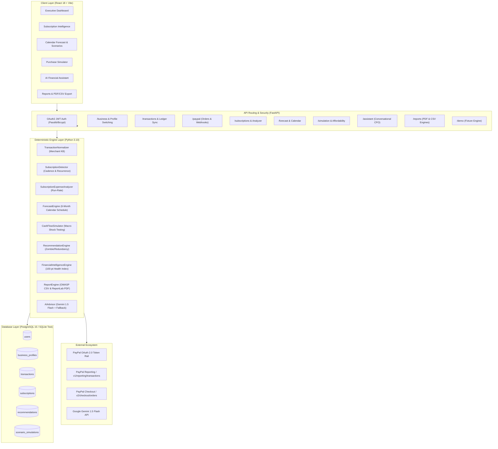
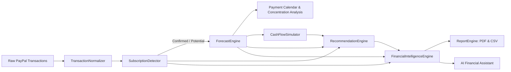
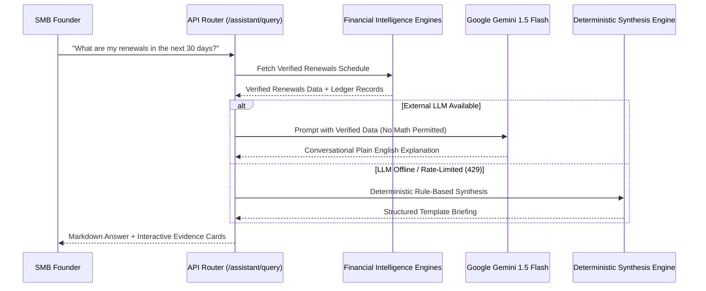

# PayPal SubWise AI — Technical Architecture Documentation

---

## 1. Executive Technical Overview

**PayPal SubWise AI** is a production-grade, calendar-aware financial intelligence and subscription analytics platform designed specifically for small-to-medium businesses (SMBs). The application connects to PayPal's Developer Sandbox and Production APIs to ingest completed transaction streams, detect recurring software overhead, forecast forward liquidity across multi-macro scenarios, simulate purchase affordability, and deliver grounded conversational insights through an evidence-backed AI Financial Assistant.

### Core Architectural Principles
1. **Deterministic-First Financial Math**: All cash calculations, burn rates, runway estimates, renewal schedules, and affordability verdicts are executed strictly by deterministic Python backend services. Large Language Models (LLMs) are **never** permitted to compute math independently.
2. **Strict Financial Accounting Integrity**: Account balance funding adjustments, wallet top-ups, incoming customer sales, and internal sandbox test payments are strictly isolated and never classified as subscription expenses.
3. **Evidence-Grounded Intelligence**: Every conversational AI response and executive briefing is tethered to verifiable database ledger records with explicit audit trails.
4. **Resilient Offline Fallback**: In the event of external API throttling or network failure, all intelligence modules seamlessly operate using internal deterministic algorithms.
5. **Multi-Tenant Profile Isolation**: Users can seamlessly switch between live/sandbox PayPal accounts and isolated demonstration environments (`DemoTech Solutions`) without cross-contamination.

---

## 2. High-Level System Architecture



---

## 3. Component Deep Dive

### 3.1. Frontend Architecture (React 18 + Vite)
- **Framework & Build**: Vite 5 + React 18 SPA with client-side routing via `react-router-dom` v6.
- **State Management**: `AuthContext.jsx` manages active JWT tokens, business profile switching, demo mode toggles, and live profile updates.
- **Styling Architecture**: Pure CSS custom properties (variables) adhering strictly to fintech standards:
  - Deep Navy: `#003087` (Primary brand)
  - Classic Blue: `#0070BA` (Action interactive)
  - Light Cyan: `#00CFE8` (Accents)
  - Dark Slate: `#0F172A` / `#1E293B` (Typography)
  - Emerald: `#059669` (Liquidity positive)
  - Amber / Rose: `#D97706` / `#E11D48` (Risk warnings)
- **Visual Analytics**: Interactive data visualizations rendered using SVG-based modular chart components (`IncomeExpenseChart`, `SubscriptionSpendingChart`, `CashFlowTrendChart`, `CategoryPieChart`).
- **HTTP Transport**: Centralized `apiClient` (`axios`) with automatic JWT injection and `X-SubWise-Demo-Mode` header resolution.

### 3.2. Backend Framework (FastAPI + Pydantic v2)
- **Runtime**: FastAPI 0.110+ on Python 3.10 with ASGI `uvicorn`.
- **Validation**: Strict Pydantic v2 schemas (`BaseModel` with `ConfigDict(from_attributes=True)`).
- **Asynchronous Execution**: Thread-pool offloading for blocking file generation (ReportLab PDF compilation, large CSV streams) while keeping API endpoints responsive.

### 3.3. Database Layer & Schema Architecture (PostgreSQL)
- **ORM**: SQLAlchemy 2.0 with Alembic database migrations.
- **Core Entities & Relationships**:
  - `User`: Primary account identity. Contains `active_business_id` and relationship `businesses = relationship("BusinessProfile", back_populates="owner")`.
  - `BusinessProfile`: Represents a legal enterprise tenant. Contains composite unique constraint `(user_id, is_demo)`, allowing each user to concurrently own a standard PayPal Sandbox profile and an isolated `DemoTech Solutions` profile.
  - `Transaction`: Normalized financial transactions. Tracks `gross_amount`, `fee_amount`, `net_amount`, `currency`, `status`, `data_source` (`paypal_api`, `demo_fixture`), and `is_simulated`.
  - `Subscription`: Detected recurring software commitments. Stores `vendor_name`, `cadence` (`weekly`, `monthly`, `quarterly`, `annual`), `detection_type` (`confirmed`, `potential`, `uncertain`), `price_change_pct`, and `next_billing_date`.
  - `Recommendation`: Actionable optimization items (e.g., `CONSOLIDATE`, `CANCEL`, `SWITCH_ANNUAL`).
  - `ScenarioSimulation`: Persisted macro stress tests.

---

## 4. PayPal Integration Architecture

### 4.1. OAuth 2.0 Authentication Rail
- **Endpoint**: `https://api-m.sandbox.paypal.com/v1/oauth2/token`
- **Grant Type**: `client_credentials`
- **Security**: Client Secret is encrypted in transit and stored server-side in `.env`. The frontend never accesses raw client secrets; the `/paypal/status` endpoint returns exclusively masked previews (`first 6 + ... + last 4`).
- **Token Lifecycle**: Tokens are cached in-memory with expiration buffer handling (renewed 120 seconds before expiry).

### 4.2. Transaction Search & Reporting API
- **Endpoint**: `/v1/reporting/transactions`
- **Parameters**: `start_date`, `end_date`, `fields=all`, `page_size=100`.
- **Duplicate Prevention**: Ingestion implements an idempotent upsert key:
  1. Primary: `paypal_transaction_id` unique match.
  2. Fallback Signature: `(transaction_date, round(gross_amount, 2), raw_description)`.
- **Directional Filtering**:
  - Positive gross transactions ($> 0$) are classified as sales revenue or account funding.
  - Negative gross transactions ($< 0$) are evaluated as operating expenses or software subscriptions.

### 4.3. Orders v2 API (Sandbox Payment Simulation)
- **Endpoints**:
  - Order Creation: `POST /v2/checkout/orders` with `intent: CAPTURE`.
  - Order Capture: `POST /v2/checkout/orders/{id}/capture`.
- **Purpose**: Enables live testing of real PayPal checkout payments in the sandbox directly from the UI to verify transaction sync workflows.

---

## 5. Algorithmic Intelligence Engines



### 5.1. Normalization & Directional Filtering (`TransactionNormalizer`)
- Maps noisy merchant descriptors to canonical profiles using a comprehensive 35+ provider knowledge registry (`MERCHANT_REGISTRY`).
- **Non-Operating Keywords Filter**:
  ```python
  NON_OPERATING_KEYWORDS = [
      "initial balance", "account funding", "balance adjustment", 
      "general funding", "deposit", "bank transfer", "wallet funding", 
      "reserve deposit", "top up", "reversal", "adjustment", "paypal balance"
  ]
  ```
  Transactions containing these keywords are strictly excluded from operating cash flow.
- **SubWise Test Filter**: Internal test payments (such as the $5.00 Orders v2 test payment) are tagged and excluded from historical subscription spending.

### 5.2. Hybrid Subscription Detection (`SubscriptionDetector`)
The engine combines dictionary matching with statistical inter-arrival time deltas:
1. **Cadence Inter-Arrival Math**:
   For any vendor with $N \ge 2$ payments at dates $d_1, d_2, \dots, d_N$:
   $$\Delta_i = d_i - d_{i-1} \quad \text{for } i \in \{2, \dots, N\}$$
   $$\text{Median Interval } M = \text{median}(\Delta_1, \dots, \Delta_{N-1})$$
   $$\text{Std Dev } \sigma = \text{std}(\Delta_1, \dots, \Delta_{N-1})$$
   - $5 \le M \le 9 \implies \text{Weekly}$
   - $25 \le M \le 35 \implies \text{Monthly}$
   - $80 \le M \le 100 \implies \text{Quarterly}$
   - $340 \le M \le 390 \implies \text{Annual}$
2. **Confidence Score**:
   $$\text{Confidence} = \max\left(0.60, \min\left(0.99, 1.0 - \frac{\sigma}{15.0}\right)\right)$$
3. **Classification Taxonomy**:
   - **Confirmed**: Supported by multiple recurring cycles at stable intervals or confirmed enterprise SaaS providers.
   - **Potential**: Single disbursements to recognized SaaS providers awaiting a second cycle (e.g. *Linear*).
   - **Uncertain**: Irregular payments to unclassified merchants.
4. **Price Creep Detection**:
   $$\text{Creep } \% = \left(\frac{\text{Latest Amount} - \text{Earliest Amount}}{\text{Earliest Amount}}\right) \times 100$$
   If Creep $\% \ge 20.0\%$, the subscription is flagged as `at_risk`.

### 5.3. Calendar-Aware Forecasting & Scenario Modeling (`ForecastEngine`)
Unlike simplistic models that divide annual expenses by 12, SubWise models actual calendar payment events:
1. **Forward Renewal Scheduling**: Every subscription's `next_billing_date` is projected forward across the 6-month horizon using its cadence step.
2. **Renewal Concentration Warning**: If scheduled subscription commitments in any 7-day window exceed $35\%$ of total monthly subscription overhead, the engine flags a liquidity concentration alert.
3. **Multi-Scenario Modeling**:
   - **Baseline**: Historical average operating revenue and non-subscription expenses.
   - **Optimistic**: $+15\%$ revenue growth; contractual subscription obligations remain fixed.
   - **Conservative**: $-20\%$ revenue dip; contractual subscription obligations remain fixed.
4. **Closing Cash Balance Projection**:
   $$\text{Cash}_{m} = \text{Cash}_{m-1} + \text{Revenue}_{m} - (\text{NonSubExpenses}_{m} + \text{ScheduledSubs}_{m})$$

### 5.4. Purchase Affordability Simulator (`CashFlowSimulator` / `RecommendationEngine`)
When a founder asks *"Can I afford X tool at \$Y/month?"*:
1. The backend simulates the immediate cash outflow and forward commitments over a 12-month horizon.
2. It monitors projected liquid cash reserves against the business's target runway buffer ($R_{\text{target}} = 6$ months).
3. Produces a deterministic verdict:
   - **Affordable**: Reserves remain comfortably above target runway.
   - **Affordable with Caution**: Lowers runway buffer but remains cash-positive.
   - **Postpone / Not Recommended**: Causes cash depletion or breaches critical reserve limits.

### 5.5. 100-Point Financial Health Index (`FinancialIntelligenceEngine`)
A deterministic, audited scoring methodology across 5 pillars:
1. **Subscription Burden Ratio (30 pts)**: Software spend relative to operating revenue ($\le 10\% \to 30\text{ pts}$; $> 40\% \to 0\text{ pts}$).
2. **Net Cash Flow Positive (25 pts)**: Whether operating revenue covers all disbursements ($> 0 \to 25\text{ pts}$; $< 0 \to 0\text{ pts}$).
3. **Cash Runway Adequacy (25 pts)**: Liquid cash divided by monthly net burn ($\ge 12\text{ mos} \to 25\text{ pts}$; $< 3\text{ mos} \to 0\text{ pts}$).
4. **Renewal Concentration Risk (10 pts)**: Penalizes severe renewal clustering in short calendar windows.
5. **Data Sufficiency Status (10 pts)**: Rewards ledger depth ($\ge 6\text{ months of completed data}$).
*Note: If transaction records are insufficient ($< 2$ months), the engine withholds the score and labels the business `Unscored – Insufficient Evidence`.*

---

## 6. AI Architecture: Provider-Independent & Evidence-Grounded



### Deterministic Fallback Mechanism
If the Google Gemini API key is unset, network fails, or quota is exhausted (HTTP 429), the assistant automatically invokes `AIAdvisor._deterministic_query_response()`. The response returns structured evidence cards citing exact merchant names, dates, and amounts without service disruption.

---

## 7. Security, Tenant Isolation & Formula Injection Protection

| Security Vector | Implementation Detail | Audit Status |
| :--- | :--- | :--- |
| **Authentication** | Passlib `bcrypt` salted password hashing; HMAC-SHA256 JWT tokens with 7-day expiration. | Verified |
| **Tenant Isolation** | Every database query filters strictly by `business_id == active_business.id`. Standard Sandbox and Demo profiles are separated by `is_demo`. | Verified |
| **Credential Security** | PayPal client ID & secret stored in `.env`. Only masked ID preview returned to client. | Verified |
| **SQL Injection** | 100% SQLAlchemy ORM parameterized queries; 0 raw SQL string concatenations. | Verified |
| **CSV Formula Injection** | Cells starting with `=, +, -, @, \t, \r` are sanitized by prepending a single quote `'` unless purely numeric. | Verified |
| **PDF Generation Security** | Built using ReportLab Flowables with safe numeric calculations; no external headless browsers or unsandboxed renderers. | Verified |

---

## 8. Known Limitations & Roadmap

1. **Live Bank Account Integration**: Tracks disbursements settled through PayPal rails; future releases will integrate Plaid/Open Banking for multi-bank consolidated cash views.
2. **Automated Webhook Cancellation**: SubWise currently delivers step-by-step downgrade workflows and negotiation scripts; direct one-click subscription cancellation via PayPal Webhook subscriptions API is scheduled for Stage 10.
3. **Multi-Currency Hedging**: Transactions are normalized to USD; real-time foreign exchange rate conversion for multi-currency international billing will be enhanced in future updates.

